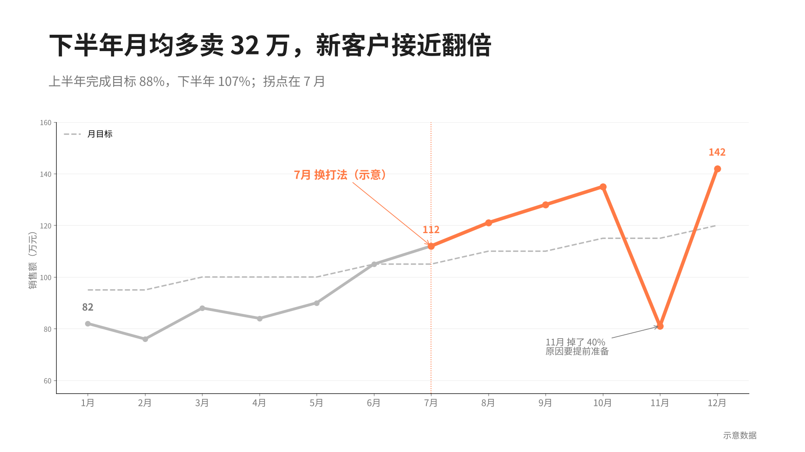

# 汇报数据 Skill（ai-report-skills）

把一张表，做成一份讲得清、抗得住追问的汇报。专为年终总结、述职、季度复盘设计的 5 个 Claude Skill，全中文。

数据清洗 AI 已经做得不错了；汇报真正难的，是从一堆数字里挑出主线，让老板听完记住一句话，被追问时不崩。这套 skill 把这件事拆成 5 步。



## 5 个 skill
| Skill | 做什么 |
| --- | --- |
| `report-flow` 汇报总控 | 先问清讲给谁听、他关心什么、讲几页，再按顺序调用下面 4 个 |
| `data-checkup` 数据体检 | 查漏月、重复行、空值、单位突变、大起大落；只出问题清单，你确认了才改（自带检查脚本） |
| `find-conclusions` 找结论 | 3–5 条结论，每条带对比基线和计算出处；好消息坏消息都找 |
| `story-builder` 讲成故事 | 按「一句话结论 → 基线 → 转折 → 洞察 → 明年怎么做」排页，标题写成观点，百分比翻译成老板的话 |
| `boss-grill` 模拟质询 | 扮演挑剔的老板一页页追问，点评你的回答，最后给一份必备弹药清单 |

## 三条规矩
- **数字可追溯**：每个数字都能指回原表的哪几行、哪一列、什么公式，并且用代码算，不心算
- **不编**：数据里没有的原因和经历，标成【待你补充】问你
- **先问再改**：异常可能是业务事实，体检只报问题，改不改你说了算

## 看一个完整例子
`examples/` 里有一份故意埋了坑的示意数据（漏月、重复行、单位写错），以及从体检到质询的完整记录：[示意_完整跑通.md](examples/示意_完整跑通.md)。
其中最值得看的一点：不体检，全年会被算成「完成目标 101%」；体检之后，真实数字是 98%。

## 安装
**网页版 / 桌面版 Claude**
1. 到 [Releases](../../releases) 或 `dist/` 下载 ZIP（每个 skill 一个，建议 5 个都装）
2. Claude →「自定义 → 技能」（Customize > Skills）→「+」→「创建技能 → 上传技能」→ 选 ZIP
3. 打开开关。之后上传表格说「帮我做年终汇报」就会自动用上

需要开启「代码执行和文件创建」，因为体检脚本和计算都要跑代码。

**Claude Code**
```bash
git clone https://github.com/huaxialucaicaizi/ai-report-skills
cp -r ai-report-skills/skills/* ~/.claude/skills/
```

## 怎么用
上传表格后，直接说：
> 这是我今年的销售数据，下周要给部门负责人做年终汇报，5 分钟，帮我从头做一遍。

也可以只用其中一步：
> 帮我体检一下这个表 ／ 帮我把这几条结论排成 5 页 PPT ／ 你扮演我老板，问我几个最狠的问题

## 参考与致谢
- 「结论先行」来自 Barbara Minto 的金字塔原理
- 「铺垫 → 冲突 → 解决」是经典的叙事结构，数据叙事领域常用
- 所有 skill 内容为本仓库原创

## 作者
华夏路菜菜子（AI 创业者）。欢迎提 Issue 告诉我你的汇报场景。

## 许可
MIT
